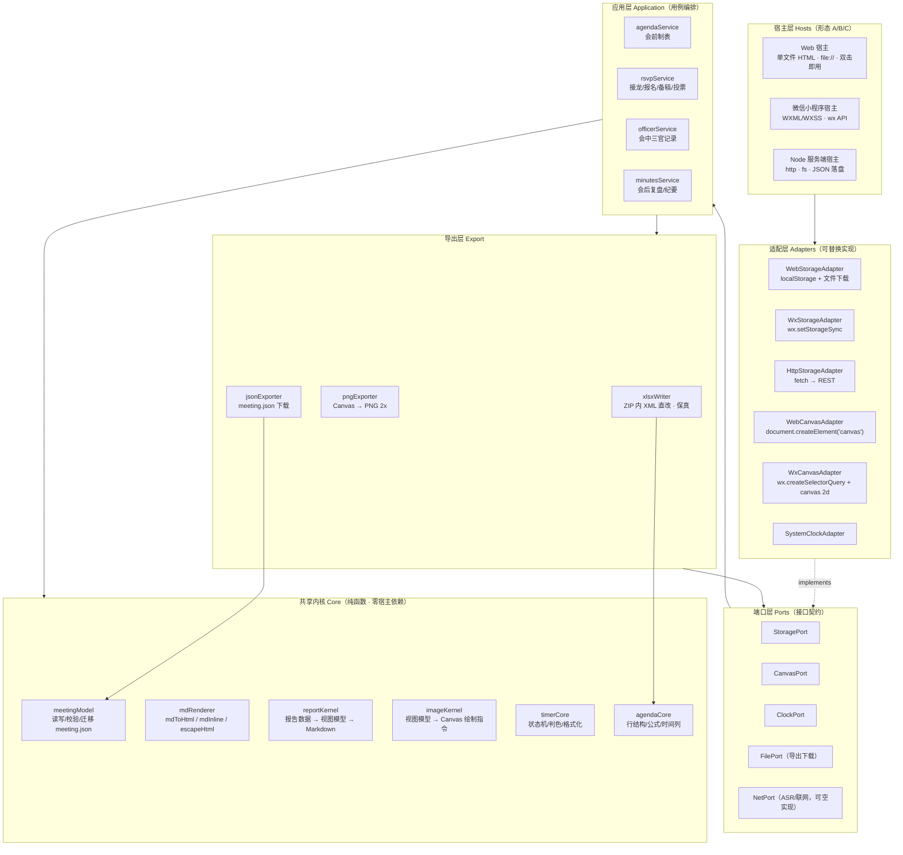
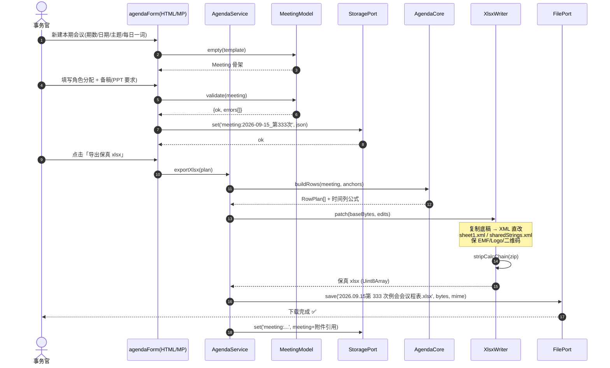
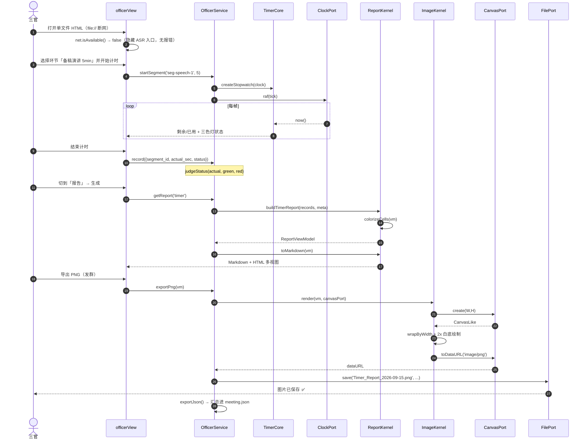
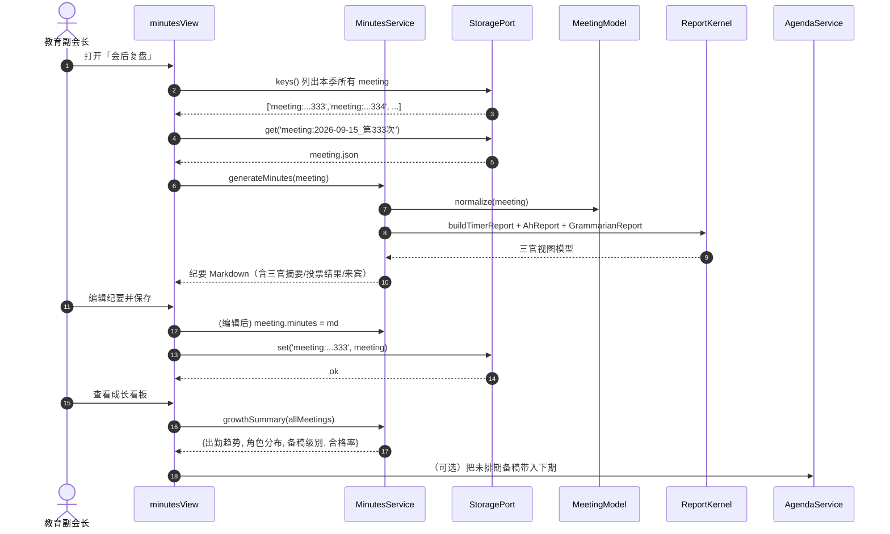
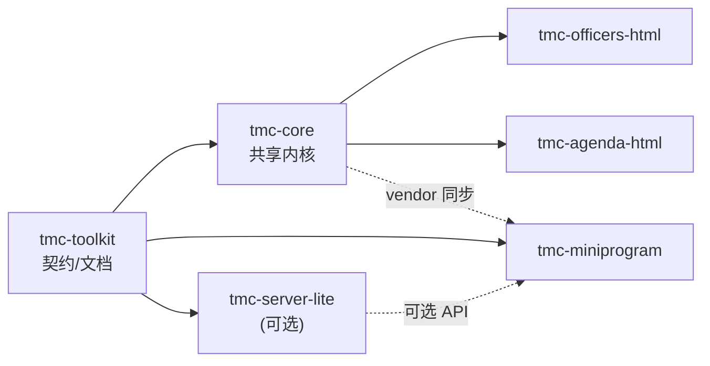
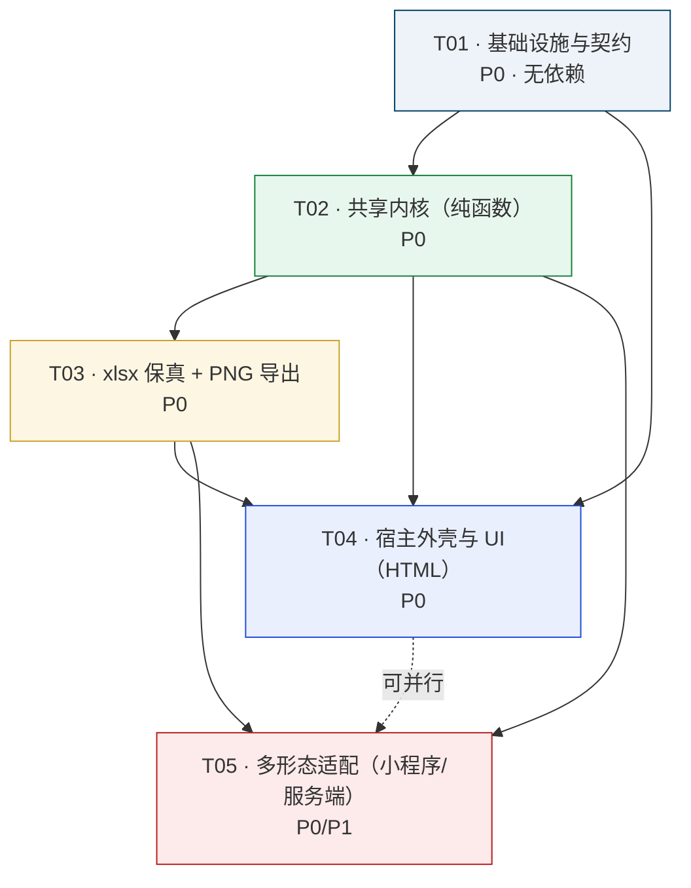

# TMC Toolkit 系统架构设计 + 任务分解

> **项目所有者 / Owner**：Altair Li（GitHub: `Altairpaca`，Email: `altairpaca@gmail.com`，HKUST(GZ)，广州南沙）
> **文档版本**：v1.0
> **架构师**：高见远（Gao）· 软件架构师
> **上游输入**：`docs/PRD.md`（PM 许清楚）、`docs/context-brief.md`（主理人 齐活林）
> **文档语言**：简体中文
> **设计哲学**：单文件零依赖 + 零后端 + 本地优先（local-first）；小程序形态因平台限制例外。

---

## 目录

- [Part A · 系统设计](#part-a--系统设计)
  1. [实现思路与框架选型](#1-实现思路与框架选型)
  2. [架构总览（分层）](#2-架构总览分层)
  3. [多形态适配设计（核心）](#3-多形态适配设计核心)
  4. [可插拔模块契约](#4-可插拔模块契约)
  5. [`meeting.json` 正式 Schema](#5-meetingjson-正式-schema)
  6. [文件列表（各 Repo 文件树）](#6-文件列表各-repo-文件树)
  7. [数据结构与接口（类图）](#7-数据结构与接口类图)
  8. [程序调用流程（时序图）](#8-程序调用流程时序图)
  9. [构建方案（零依赖内联）](#9-构建方案零依赖内联)
  10. [依赖包列表](#10-依赖包列表)
  11. [共享知识（跨文件约定）](#11-共享知识跨文件约定)
  12. [待澄清事项与假设](#12-待澄清事项与假设)
- [Part B · 任务分解](#part-b--任务分解)
  - [13. 任务列表](#13-任务列表)
  - [14. Repo 拆分最终方案](#14-repo-拆分最终方案)
  - [15. 任务依赖图](#15-任务依赖图)

---

# Part A · 系统设计

## 1. 实现思路与框架选型

### 1.1 核心挑战分析

| # | 挑战 | 本质 | 对策 |
|---|------|------|------|
| C1 | **一套内核，三种宿主** | 同一份业务逻辑要跑在「浏览器 DOM / 微信小程序（无 DOM）/ Node 服务端」三种运行时 | 提炼**无宿主依赖的纯函数内核**（`/core`），差异全部收敛到**适配层接口**（storage / canvas / clock / dom） |
| C2 | **单文件自包含** | HTML 版要求一个文件装下全部、零 CDN、`file://` 直开 | 源码模块化开发 → **构建期内联**（`build/inline.js` 把 `/core` + `/render` + 样式塞进单 HTML） |
| C3 | **xlsx 保真导出** | 既有议程含 EMF/Logo/二维码/Drawing，openpyxl 重存会丢对象 | **不重造轮子**：复用已验证的「复制底稿 + ZIP 内 XML 直改 `sheet1.xml`/`sharedStrings.xml`/`drawings`」手法；删除 `xl/calcChain.xml` |
| C4 | **报告渲染内核复用** | HTML 版与小程序版都要出多视图报告 + Canvas PNG | 内核纯函数化：`mdToHtml()` / `buildReportImage()` 只依赖**抽象 canvas 上下文**，不碰 `document` |
| C5 | **单一事实源** | 三阶段（会前/会中/会后）读写同一份数据 | `meeting.json` **JSON Schema 先行**，模块间仅通过它耦合 |
| C6 | **离线降级** | ASR 等联网增强在断网时不可用 | 能力探测 + **优雅降级**：功能开关探测失败即隐藏入口，核心功能不受影响 |

### 1.2 技术选型

| 层面 | 选型 | 理由 |
|------|------|------|
| **语言** | 原生 **JavaScript ES2020（UMD 风格 IIFE）**，零 TypeScript 编译依赖 | 单文件 HTML 要求无构建工具链；TS 类型仅用于**设计文档与 JSDoc 注释**，不引入编译器 |
| **内核架构** | **纯函数内核 + 适配器模式（Ports & Adapters / 六边形架构）** | 业务逻辑不感知宿主，适配层可替换（localStorage / wx.storage / HTTP API） |
| **HTML 版** | 原生 HTML/CSS/JS，**无任何框架、无 CDN** | 硬约束：`file://` 直开、断网可用、单文件 |
| **小程序版** | **微信小程序原生（WXML/WXSS/JS）** | 平台约束；避免 Taro 等编译链的额外依赖；内核直接用 `require` 引入 |
| **服务端（可选）** | **Node.js 18+ 原生 `http` 模块**（零 npm 依赖） | 「极轻量服务端」定位，最小必要；JSON 文件落盘 |
| **构建** | **零依赖 Node 脚本**（`build/inline.js`） | 不引入 webpack/vite；仅用 Node 内建 `fs`/`path` |
| **测试** | 延续 `_selftest.js` 范式：**node 直跑、零依赖、纯逻辑断言** | 已有 34 项测试范式可直接复用 |
| **保真 xlsx** | **Node 内建 `zlib` + 自研 ZIP 读写**（或 Python `zipfile` 版并行） | 禁用 openpyxl；直接操作 OOXML |

### 1.3 架构模式

采用 **六边形架构（Hexagonal / Ports & Adapters）**：

```
        ┌─────────────────── Adapters (宿主) ───────────────────┐
        │  WebAdapter   MiniprogramAdapter   NodeAdapter        │
        └───────────────┬───────────┬──────────────┬────────────┘
                        ▼           ▼              ▼
        ┌─────────────── Ports 接口层（Port Definitions）────────┐
        │  StoragePort  CanvasPort  ClockPort  DomPort  NetPort  │
        └───────────────┬───────────────────────────────────────┘
                        ▼
        ┌──────────── 应用层（Application / Use-Cases）─────────┐
        │  agendaService  officerService  minutesService         │
        └───────────────┬───────────────────────────────────────┘
                        ▼
        ┌──────────── 内核层（Core · 纯函数）───────────────────┐
        │  meetingModel  reportKernel  xlsxWriter  mdRenderer    │
        └───────────────────────────────────────────────────────┘
```

**规则**：依赖只能由外向内（Adapter → Port → Application → Core）。内核层**禁止**出现 `window`、`document`、`localStorage`、`wx.`、`require('fs')`、`fetch` 等宿主符号。

---

## 2. 架构总览（分层）



**各层职责表**：

| 层 | 职责 | 允许依赖 | 关键约束 |
|----|------|---------|---------|
| **宿主层 Hosts** | 提供 UI 外壳与运行环境（浏览器/小程序/Node） | 适配层 | 不含业务逻辑 |
| **适配层 Adapters** | 把宿主 API 封装成端口接口；唯一可触碰平台 API 的地方 | 端口层 | 每个端口至少 1 个 Web 实现 |
| **端口层 Ports** | 定义接口契约（方法签名），供应用层调用 | 无 | 只声明、不实现 |
| **应用层 Application** | 编排用例流程（会前/会中/会后），调用内核与导出 | 内核、导出、端口 | 不直接调宿主 API |
| **共享内核 Core** | 纯函数业务逻辑；可被三种宿主复用 | 无（纯函数） | 禁止宿主符号；可单测 |
| **导出层 Export** | xlsx 保真写入、PNG 生成、JSON 下载 | 内核、端口 | xlsx 禁 openpyxl |

---

## 3. 多形态适配设计（核心）

同一套 `/core` 内核，通过**注入不同的适配器实例**适配三种宿主。所有适配器实现同一组端口接口，因此应用层与内核层**零改动**即可移植。

### 3.1 三种宿主对照

| 关注点 | ① 类 GC 自包含 HTML | ② 微信小程序 | ③ BS 模型（浏览器+服务端） |
|--------|--------------------|-------------|--------------------------|
| 构建方式 | 构建期把 `/core` 与 `/render` **内联**进单 HTML | `require('../../core/index.js')` 直接引用 | 构建期内联（同①），另加 `fetch` 适配 |
| 存储 | `localStorage` | `wx.setStorageSync` / `wx.getStorageSync` | 服务端 REST + 本地缓存兜底 |
| Canvas | `document.createElement('canvas')` | `wx.createSelectorQuery().select('#c').fields({node:true})` → `canvas 2d` | 同① |
| 时钟 | `performance.now()` / `Date.now()` | `Date.now()` | 同① |
| 文件导出 | `<a download>` + `Blob`/`URL.createObjectURL` | `wx.saveFileToDisk` / `wx.getFileSystemManager().writeFile` | 服务端生成 + 下载链接 |
| DOM 渲染 | `innerHTML` + `colorizeStatus()` | WXML 数据绑定（无 `innerHTML`），`colorizeStatus` 逻辑改为**返回带 class 的视图模型** | 同① |
| 网络 | 默认无；ASR 为可关闭增强 | `wx.request` | `fetch` |
| 内核复用 | ✅ 全量 | ✅ 全量（除 DOM 相关） | ✅ 全量 |

### 3.2 适配层接口设计（端口契约）

以 JSDoc 类型签名表达（运行时为普通对象/类）：

#### 3.2.1 StoragePort — 键值存储

```js
/**
 * @typedef {Object} StoragePort
 * @property {(key: string) => string|null} get          // 同步读字符串
 * @property {(key: string, value: string) => void} set  // 同步写字符串
 * @property {(key: string) => void} remove              // 删除
 * @property {() => string[]} keys                       // 列出所有键
 * @property {(key: string, cb:(v:string|null)=>void) => void} [getAsync] // 小程序/HTTP 异步读（可选）
 */
```

**三个实现**：

| 实现 | 落在 | 关键代码 |
|------|------|---------|
| `WebStorageAdapter` | `tmc-*-html/adapters/web-storage.js` | `return localStorage.getItem(key)` |
| `WxStorageAdapter` | `tmc-miniprogram/adapters/wx-storage.js` | `return wx.getStorageSync(key) \|\| null` |
| `HttpStorageAdapter` | `tmc-server-lite/adapters/http-storage.js` | `fetch(base + '/kv/' + key)` |

#### 3.2.2 CanvasPort — 画布工厂（解耦 DOM）

```js
/**
 * @typedef {Object} CanvasPort
 * @property {(w:number,h:number)=>CanvasLike} create  // 创建离屏画布
 * @property {(id:string)=>Promise<CanvasLike|null>} acquire // 小程序：拿页面 canvas node
 * @typedef {Object} CanvasLike
 * @property {number} width
 * @property {number} height
 * @property {Canvas2DContext} getContext
 * @property {(type?:string)=>string|Promise<string>} toDataURL // 小程序需 wx.canvasToTempFilePath 包装
 */
```

> **关键**：`imageKernel` 只接受 `CanvasPort` 产出的 `CanvasLike`，内部用标准 2D 指令（`fillRect`/`fillText`/`measureText`/`arcTo`），三宿主通用。`wrapByWidth(ctx, text, maxW)` 与 `roundRectPath` 原样平移进内核。

#### 3.2.3 ClockPort — 时钟

```js
/**
 * @typedef {Object} ClockPort
 * @property {() => number} now         // 毫秒时间戳（单调优先，用于计时）
 * @property {() => number} wallClock   // 墙钟 Date.now()
 * @property {(cb:FrameRequestCallback)=>number} raf  // 浏览器 rAF / 小程序 canvas.requestAnimationFrame / Node setTimeout(16)
 * @property {(h:number)=>void} cancelRaf
 */
```

#### 3.2.4 FilePort — 文件导出

```js
/**
 * @typedef {Object} FilePort
 * @property {(name:string, blob:Blob|Uint8Array, mime:string)=>Promise<void>} save
 */
```

- Web：`URL.createObjectURL` + `<a download>`
- 小程序：`wx.getFileSystemManager().writeFile({filePath: wx.env.USER_DATA_PATH+'/'+name})` + `wx.saveFileToDisk`
- Server：返回下载 URL

#### 3.2.5 NetPort — 联网增强（可空实现，支持降级）

```js
/**
 * @typedef {Object} NetPort
 * @property {() => boolean} isAvailable     // 能力探测；false 时上层隐藏入口
 * @property {(url:string, opts:Object) => Promise<any>} request
 * @property {Object} [asr]                  // 语音识别（可选）
 */
// 空实现（离线默认）：
const NullNetPort = { isAvailable: () => false, request: () => Promise.reject(new Error('offline')) };
```

**降级约定**：应用层启动时调用 `net.isAvailable()`；为 `false` 则**隐藏** ASR/联网入口，**不抛异常、不弹错**。

### 3.3 适配装配（Composition Root）

```js
// core 层暴露：createApp({ storage, canvas, clock, file, net }) => app
// Web 宿主（内联版）：src/host-web.js
const app = TMC.createApp({
  storage: TMC.WebStorageAdapter(),
  canvas:  TMC.WebCanvasAdapter(),
  clock:   TMC.SystemClockAdapter(),
  file:    TMC.WebFileAdapter(),
  net:     TMC.NullNetPort,        // 离线默认；联网版传 WebNetAdapter
});

// 微信小程序宿主：miniprogram/app.js
const app = require('../../core/index.js').createApp({
  storage: require('./adapters/wx-storage.js'),
  canvas:  require('./adapters/wx-canvas.js'),
  clock:   require('./adapters/wx-clock.js'),
  file:    require('./adapters/wx-file.js'),
  net:     require('./adapters/wx-net.js'),
});
```

---

## 4. 可插拔模块契约

> PRD §4.1 的工程化落地。每个模块：**输入 → 输出 → 依赖 → 可替换实现**，并给出接口签名。

| # | 模块 | 输入 | 输出 | 依赖 | 内核文件 | 可替换实现 |
|---|------|------|------|------|---------|-----------|
| M1 | **meetingModel** | `meeting.json` 对象 / JSON 字符串 | 校验结果、规范化对象、迁移后对象 | 无 | `core/meeting-model.js` | 唯一（契约实现） |
| M2 | **mdRenderer** | Markdown 字符串 | HTML 字符串 / 内联片段 | 无 | `core/md-renderer.js` | 唯一（GFM 子集） |
| M3 | **reportKernel** | 记录数据 + 元数据（timer/ah/grammarian） | `ReportViewModel` + Markdown + 纯文本 | M2 | `core/report-kernel.js` | 唯一 |
| M4 | **imageKernel** | `ReportViewModel` + `CanvasPort` | 绘制指令 / `CanvasLike`（可导出 PNG） | CanvasPort | `core/image-kernel.js` | 唯一 |
| M5 | **timerCore** | 计时节拍事件 | 计时状态、判色、格式化 | ClockPort | `core/timer-core.js` | 唯一 |
| M6 | **agendaCore** | `meeting.json` 议程段 + 底稿锚点信息 | 行结构、时间列公式、占位符替换表 | M1 | `core/agenda-core.js` | 唯一 |
| M7 | **xlsxWriter** | 底稿 xlsx（ArrayBuffer）+ 替换表 | 保真 xlsx（Uint8Array） | M6 | `core/xlsx-writer.js` | 唯一（保真方法固定） |
| M8 | **agendaService** | 会议元数据 + 角色 + 模板 | 议程预览 + 保真 xlsx | M1,M6,M7 | `app/agenda-service.js` | HTML / 小程序 |
| M9 | **rsvpService** | 会议 ID + 来宾信息 | 报名清单 / 备稿队列 / 投票结果 | M1, StoragePort | `app/rsvp-service.js` | 本地 / 在线 |
| M10 | **officerService** | 会议 ID + 现场事件 | 三官记录数据 | M1,M5, StoragePort | `app/officer-service.js` | 计时/哼哈/语法分模块 |
| M11 | **minutesService** | 三阶段全部数据 | 纪要 Markdown + 复盘视图 | M1,M3 | `app/minutes-service.js` | 唯一 |
| M12 | **storagePort** | 键值读写 | 持久化 | 无 | `ports/*.js` | localStorage / wx / HTTP |

### 4.1 关键接口定义（TS 类型，仅供参考；运行时为 JS）

```ts
// ---- 数据契约（见 §5）----
interface Meeting { meeting_id: string; /* ... 完整字段见 §5 */ }

// ---- 端口 ----
interface StoragePort { get(k:string):string|null; set(k:string,v:string):void; remove(k:string):void; keys():string[]; }
interface CanvasLike { width:number; height:number; getContext(t:'2d'):CanvasRenderingContext2D; toDataURL(t?:string):string | Promise<string>; }
interface CanvasPort { create(w:number,h:number):CanvasLike; }
interface ClockPort { now():number; wallClock():number; raf(cb:FrameRequestCallback):number; cancelRaf(h:number):void; }
interface FilePort { save(name:string, data:Blob|Uint8Array, mime:string):Promise<void>; }
interface NetPort { isAvailable():boolean; request(url:string, opts?:object):Promise<any>; }
interface Adapters { storage:StoragePort; canvas:CanvasPort; clock:ClockPort; file:FilePort; net:NetPort; }

// ---- 内核 ----
interface MeetingModel {
  validate(raw:unknown): { ok:boolean; errors:string[] };
  migrate(raw:any): Meeting;                 // 旧版本 → 当前版本
  normalize(m:Meeting): Meeting;
  empty(template?:Partial<Meeting>): Meeting;
}
interface MdRenderer { toHtml(md:string):string; inline(s:string):string; escapeHtml(s:string):string; }
interface TimerCore {
  judgeStatus(seconds:number, greenSec:number, redSec:number): 'under'|'ok'|'over';
  formatTime(sec:number): string;            // → "5:30" / "0:35"
  createStopwatch(clock:ClockPort): Stopwatch;
}
interface XlsxWriter {
  patch(baseBytes:Uint8Array, edits: CellEdit[]): Uint8Array;   // 纯 XML 直改
  stripCalcChain(zip: ZipLike): void;                            // 删除 calcChain.xml
}
interface CellEdit { sheet:string; ref:string; value:string; isFormula?:boolean; }

// ---- 应用 ----
interface AgendaService {
  buildAgenda(meeting:Meeting, opts:{ templateId:string }): AgendaPlan;
  preview(plan:AgendaPlan): ReportViewModel;         // 渲染预览
  exportXlsx(plan:AgendaPlan): Promise<Uint8Array>;  // 保真 xlsx
}
interface OfficerService {
  startSegment(segId:string, plannedMin:number): void;
  record(entry:OfficerEntry): void;
  getReport(kind:'timer'|'ah'|'grammarian'): ReportViewModel;
  exportPng(view:ReportViewModel): Promise<string>;  // dataURL / 文件路径
  exportJson(): Meeting;
}

// ---- 应用工厂 ----
function createApp(adapters:Adapters): {
  meeting: MeetingModel; agenda: AgendaService; officer: OfficerService;
  rsvp: RsvpService; minutes: MinutesService;
};
```

---

## 5. `meeting.json` 正式 Schema

> 基于 PRD §7 完善为**可校验**的 JSON Schema（draft-07 语义）。RFC3339 时间统一 UTC。

### 5.1 JSON Schema（draft-07）

```json
{
  "$schema": "http://json-schema.org/draft-07/schema#",
  "$id": "https://github.com/Altairpaca/tmc-toolkit/schema/meeting.schema.json",
  "title": "TMC Meeting",
  "type": "object",
  "additionalProperties": false,
  "required": ["meeting_id", "meeting_number", "date", "meta"],
  "properties": {
    "meeting_id":    { "type": "string", "pattern": "^\\d{4}-\\d{2}-\\d{2}_第\\d+次$",
                       "description": "会议唯一标识，如 2026-09-15_第333次" },
    "meeting_number":{ "type": "integer", "minimum": 1 },
    "date":          { "type": "string", "format": "date" },
    "start_time":    { "type": "string", "pattern": "^\\d{2}:\\d{2}$", "description": "如 19:15" },
    "end_time":      { "type": "string", "pattern": "^\\d{2}:\\d{2}$", "description": "如 21:30", "default": "21:30" },
    "language":      { "type": "string", "enum": ["zh", "en", "bilingual"], "default": "bilingual" },
    "theme": {
      "type": "object", "additionalProperties": false,
      "properties": { "zh": {"type":"string"}, "en": {"type":"string"} }
    },
    "word_of_the_day": {
      "type": "object", "additionalProperties": false,
      "properties": {
        "zh": {"type":"string"}, "en": {"type":"string"},
        "pos": {"type":"string", "description": "词性"},
        "example": {"type":"string"}
      }
    },
    "venue": { "type": "string", "default": "广州南沙" },
    "roles": {
      "type": "array",
      "items": {
        "type": "object", "additionalProperties": false,
        "required": ["role"],
        "properties": {
          "role":    { "$ref": "#/definitions/roleEnum" },
          "member_id": { "type": ["string","null"] },
          "name_zh": { "type": ["string","null"] },
          "name_en": { "type": ["string","null"] },
          "note":    { "type": "string" }
        }
      }
    },
    "agenda": {
      "type": "array",
      "items": {
        "type": "object", "additionalProperties": false,
        "required": ["segment_id", "type"],
        "properties": {
          "segment_id": { "type": "string" },
          "type": { "type": "string",
                    "enum": ["opening","facilitator","table_topics","prepared_speech",
                             "evaluation","workshop","report","voting","closing"] },
          "title_zh": { "type": "string" },
          "title_en": { "type": "string" },
          "presenter": { "type": "string" },
          "duration_min": { "type": "number", "minimum": 0 },
          "project": { "type": ["string","null"] },
          "buffer_min": { "type": "number", "minimum": 0, "description": "大环节缓冲（1~3）" }
        }
      }
    },
    "speeches": {
      "type": "array",
      "items": {
        "type": "object", "additionalProperties": false,
        "required": ["member_id"],
        "properties": {
          "member_id": { "type": "string" },
          "project_level": { "type": "string", "description": "L1..L5" },
          "project_title": { "type": "string" },
          "pathway":  { "type": "string" },
          "evaluator":{ "type": ["string","null"] },
          "requirements": {
            "type": "object", "additionalProperties": false,
            "properties": { "min_min": {"type":"number"}, "max_min": {"type":"number"} }
          }
        }
      }
    },
    "guests": {
      "type": "array",
      "items": {
        "type": "object", "additionalProperties": false,
        "required": ["name"],
        "properties": {
          "name": {"type":"string"}, "contact": {"type":"string"},
          "source": {"type":"string"}, "is_new": {"type":"boolean", "default": true}
        }
      }
    },
    "rsvp": {
      "type": "array",
      "items": {
        "type": "object", "additionalProperties": false,
        "required": ["name"],
        "properties": {
          "name": {"type":"string"}, "role_pref": {"type":"string"},
          "confirmed": {"type":"boolean", "default": false}
        }
      }
    },
    "ballot": {
      "type": "array",
      "items": {
        "type": "object", "additionalProperties": false,
        "required": ["category"],
        "properties": {
          "category": { "type": "string",
                        "enum": ["best_speaker","best_evaluator","best_table_topics","best_role"] },
          "candidates": { "type": "array", "items": {"type":"string"} },
          "result":     { "type": "array", "items": {"type":"string"} }
        }
      }
    },
    "officers_records": {
      "type": "object", "additionalProperties": false,
      "properties": {
        "timer": {
          "type": "array",
          "items": {
            "type": "object", "additionalProperties": false,
            "required": ["segment_id"],
            "properties": {
              "segment_id": {"type":"string"},
              "planned_min": {"type":"number"},
              "actual_sec":  {"type":"number"},
              "status": { "type": "string", "enum": ["green","yellow","red"] }
            }
          }
        },
        "ah_counter": {
          "type": "array",
          "items": {
            "type": "object", "additionalProperties": false,
            "required": ["member_id"],
            "properties": {
              "member_id": {"type":"string"},
              "counts": { "type":"object", "additionalProperties": {"type":"integer","minimum":0} },
              "top3":   { "type":"array", "items":{"type":"string"} }
            }
          }
        },
        "grammarian": {
          "type": "array",
          "items": {
            "type": "object", "additionalProperties": false,
            "required": ["member_id"],
            "properties": {
              "member_id": {"type":"string"},
              "good_phrases": { "type":"array", "items":{"type":"string"} },
              "corrections":  { "type":"array", "items":{"type":"string"} }
            }
          }
        }
      }
    },
    "minutes": { "type": "string", "description": "会后纪要（Markdown）" },
    "attachments": {
      "type": "array",
      "items": {
        "type": "object", "additionalProperties": false,
        "required": ["name"],
        "properties": { "name": {"type":"string"}, "path": {"type":"string"} }
      }
    },
    "meta": {
      "type": "object", "additionalProperties": false,
      "required": ["version", "owner", "updated_at"],
      "properties": {
        "version":  { "type": "string", "default": "1.0" },
        "owner":    { "type": "string", "default": "Altair Li" },
        "updated_at": { "type": "string", "format": "date-time" }
      }
    }
  },
  "definitions": {
    "roleEnum": {
      "type": "string",
      "enum": [
        "meeting_manager","opening","toastmaster_of_ceremony","general_evaluator",
        "timer","ah_counter","grammarian","facilitator","photographer",
        "speaker","evaluator","table_topics_master","table_topics_evaluator",
        "workshop_speaker","ballot_officer","receptionist","slides_operator",
        "computer_support","president","next_meeting_manager"
      ]
    }
  }
}
```

### 5.2 示例（合法最小实例）

```json
{
  "meeting_id": "2026-09-15_第333次",
  "meeting_number": 333,
  "date": "2026-09-15",
  "start_time": "19:15",
  "end_time": "21:30",
  "language": "bilingual",
  "theme": { "zh": "重构", "en": "Refactor" },
  "word_of_the_day": { "zh": "韧性", "en": "resilience", "pos": "n.", "example": "…" },
  "venue": "广州南沙",
  "roles": [
    { "role": "toastmaster_of_ceremony", "name_zh": "张三", "name_en": "Zhang San" },
    { "role": "timer", "name_zh": "李四", "name_en": "Li Si" }
  ],
  "agenda": [
    { "segment_id": "seg-opening", "type": "opening", "title_zh": "会议召集", "duration_min": 1 }
  ],
  "speeches": [],
  "guests": [],
  "rsvp": [],
  "ballot": [],
  "officers_records": { "timer": [], "ah_counter": [], "grammarian": [] },
  "minutes": "",
  "attachments": [],
  "meta": { "version": "1.0", "owner": "Altair Li", "updated_at": "2026-09-15T12:00:00Z" }
}
```

### 5.3 校验规则（`meetingModel.validate`）

| 规则 | 说明 |
|------|------|
| 必填 | `meeting_id` / `meeting_number` / `date` / `meta.*` 三项 |
| 唯一性 | `meeting_id` 与 `meeting_number` 在同库内唯一 |
| 角色合法性 | `roles[].role ∈ roleEnum`；未知角色进 `errors` 但不阻断 |
| 引用完整性 | `speeches[].evaluator` 若为名字需能匹配到 `roles` 中 evaluator；否则警告 |
| 时间一致性 | `end_time > start_time`；`agenda` 明细时长和 ≤ 大环节时长（PRD 缓冲规则） |
| 版本迁移 | `meta.version` 旧值 → 由 `migrate()` 补齐字段；不丢未知字段（保留在 `_extra`） |

---

## 6. 文件列表（各 Repo 文件树）

### 6.1 `tmc-toolkit`（总入口 · 契约/文档）

```
tmc-toolkit/
├── README.md                     # 项目总览 + 各 repo 导航
├── LICENSE                       # MIT · Altair Li
├── docs/
│   ├── PRD.md
│   ├── context-brief.md
│   ├── ARCHITECTURE.md           # 本文档
│   ├── sequence-diagram.mermaid
│   └── class-diagram.mermaid
├── schema/
│   ├── meeting.schema.json       # §5 的 JSON Schema
│   └── README.md                 # 契约变更流程
├── examples/
│   ├── meeting.min.json          # 最小合法样本
│   └── meeting.333.json          # 真实一期脱敏样本
└── roadmap.md
```

### 6.2 `tmc-core`（共享内核 · 纯函数，被三端复用）

> **架构决策**：把 `tmc-render-core` 扩展为通用 `tmc-core`（含渲染 + 模型 + 计时 + 议程核心），初期即抽包，避免后续拆包返工。见 §12 决策 D5。

```
tmc-core/
├── package.json                  # name: tmc-core, main: index.js, 零 dependencies
├── README.md
├── LICENSE                       # MIT
├── index.js                      # 汇总导出 + createApp 工厂
├── core/
│   ├── meeting-model.js          # M1
│   ├── md-renderer.js            # M2（移植 mdToHtml/mdInline/splitRow/alignOf/isSepRow/escapeHtml）
│   ├── report-kernel.js          # M3（移植 generateReport/generateReportMarkdown/colorizeStatus→视图模型）
│   ├── image-kernel.js           # M4（移植 buildReportImage/wrapByWidth/roundRectPath，改用 CanvasPort）
│   ├── timer-core.js             # M5（judgeStatus/formatTime/Stopwatch）
│   └── agenda-core.js            # M6（行结构/公式/时间列）
├── ports/
│   ├── storage-port.js           # 接口声明 + NullStorage
│   ├── canvas-port.js
│   ├── clock-port.js
│   ├── file-port.js
│   └── net-port.js               # NullNetPort
├── adapters/                     # 通用适配器（Web/Node 可用）
│   ├── web-storage.js
│   ├── web-canvas.js
│   ├── system-clock.js
│   ├── web-file.js
│   └── null-net.js
├── app/
│   ├── agenda-service.js         # M8
│   ├── rsvp-service.js           # M9
│   ├── officer-service.js        # M10
│   └── minutes-service.js        # M11
├── data/
│   ├── roles.js                  # roleEnum + 中英文名
│   ├── wordlist-ah.js            # 哼哈官默认词表（移植 DEFAULT_WORDS）
│   └── status-text.js            # STATUS_TEXT（移植）
└── test/
    ├── _selftest.js              # 内核纯逻辑单测（移植 + 扩展）
    └── fixtures/
        └── meeting.sample.json
```

### 6.3 `tmc-officers-html`（形态 D · 三官自包含 HTML）

```
tmc-officers-html/
├── README.md
├── LICENSE
├── package.json                  # 仅 devDependencies: tmc-core（本地 file: 引用），无运行时依赖
├── src/
│   ├── host-web.js               # 组装适配器 + createApp（§3.3）
│   ├── ui/
│   │   ├── shell.html            # 三官统一外壳模板（占位符 /*__CORE__*/ /*__STYLE__*/）
│   │   ├── shell.css             # 全局样式 + 报告版式
│   │   ├── view-timer.js         # 计时官视图
│   │   ├── view-ah.js            # 哼哈官视图
│   │   ├── view-grammarian.js    # 语法官视图
│   │   └── view-report.js        # 报告三视图 Tab + 复制/下载
│   └── store.js                  # localStorage 持久化（经 StoragePort）
├── build/
│   └── inline.js                 # 零依赖 Node 内联脚本（§9）
├── dist/                         # 构建产物（单文件，可直接分发）
│   ├── universal-timer.html      # 计时官（66KB→含内核）
│   ├── ah-counter.html           # 哼哈官
│   └── grammarian.html           # 语法官
├── tools/
│   └── start-server.py           # 本地服务器（麦克风/ASR 需 localhost）
└── test/
    └── smoke.js                  # 构建产物文件大小/关键标记冒烟检查
```

### 6.4 `tmc-agenda-html`（形态 C-HTML · 议程生成 + xlsx 保真导出）

```
tmc-agenda-html/
├── README.md
├── LICENSE
├── package.json                  # 仅 devDependencies: tmc-core
├── src/
│   ├── host-web.js
│   ├── ui/
│   │   ├── shell.html
│   │   ├── shell.css
│   │   ├── view-agenda-form.js    # 会议元数据/角色/备稿表单
│   │   ├── view-agenda-preview.js # 议程预览（时间列/公式）
│   │   └── view-export.js         # 导出面板（xlsx/pdf 提示/JSON）
│   └── xlsx/
│       ├── zip.js                 # 零依赖 ZIP 读写（读 entries + 写回）
│       ├── xml-utils.js           # sharedStrings/sheet 单元格定位
│       └── base-template.js       # 底稿载入（用户最近一期 xlsx）
├── build/
│   └── inline.js
├── templates/                     # 中立空白底稿（可选，见 Q6）
│   └── README.md
├── dist/
│   └── agenda-builder.html
└── test/
    └── smoke.js
```

### 6.5 `tmc-miniprogram`（形态 B/C · 微信小程序）

```
tmc-miniprogram/
├── README.md
├── LICENSE
├── project.config.json
├── app.js                        # createApp + Wx 适配器装配
├── app.json
├── app.wxss
├── adapters/
│   ├── wx-storage.js
│   ├── wx-canvas.js
│   ├── wx-clock.js
│   ├── wx-file.js
│   └── wx-net.js
├── pages/
│   ├── index/                    # 首页导航
│   ├── rsvp/                     # 报名接龙
│   ├── speech/                   # 备稿申请
│   ├── ballot/                   # 评选投票
│   ├── agenda/                   # 议程在线协作（只读/协作）
│   └── report/                   # 报告查看（Canvas 2d）
├── components/
│   └── report-view/              # 视图模型 → WXML 渲染
├── lib/                          # 从 tmc-core 拷贝/submodule（小程序需 vendored）
│   └── tmc-core/                 # 软链或脚本同步（见 §9.4）
└── utils/
```

### 6.6 `tmc-server-lite`（形态 B · 极轻量服务端，P2）

```
tmc-server-lite/
├── README.md
├── LICENSE
├── package.json                  # 零 dependencies，仅 Node 内建
├── server.js                     # http 服务 + 路由
├── routes/
│   ├── meetings.js               # GET/PUT /api/meetings/:id
│   ├── kv.js                     # 简易键值
│   └── rsvp.js                   # 接龙提交
├── store/
│   └── json-store.js             # 文件落盘（data/*.json）
├── data/                         # 运行时数据目录
└── test/
    └── api.test.js
```

---

## 7. 数据结构与接口（类图）

```mermaid
classDiagram
    class Adapters {
        <<interface>>
        +StoragePort storage
        +CanvasPort canvas
        +ClockPort clock
        +FilePort file
        +NetPort net
    }
    class StoragePort {
        <<interface>>
        +get(key) string
        +set(key, value) void
        +remove(key) void
        +keys() string[]
    }
    class CanvasPort {
        <<interface>>
        +create(w, h) CanvasLike
        +acquire(id) Promise~CanvasLike~
    }
    class ClockPort {
        <<interface>>
        +now() number
        +wallClock() number
        +raf(cb) number
        +cancelRaf(h) void
    }
    class FilePort {
        <<interface>>
        +save(name, data, mime) Promise~void~
    }
    class NetPort {
        <<interface>>
        +isAvailable() boolean
        +request(url, opts) Promise~any~
    }

    class WebStorageAdapter
    class WxStorageAdapter
    class HttpStorageAdapter
    class WebCanvasAdapter
    class WxCanvasAdapter
    class SystemClockAdapter

    StoragePort <|.. WebStorageAdapter
    StoragePort <|.. WxStorageAdapter
    StoragePort <|.. HttpStorageAdapter
    CanvasPort  <|.. WebCanvasAdapter
    CanvasPort  <|.. WxCanvasAdapter
    ClockPort   <|.. SystemClockAdapter

    class App {
        +MeetingModel meeting
        +AgendaService agenda
        +RsvpService rsvp
        +OfficerService officer
        +MinutesService minutes
    }
    class createApp {
        <<factory>>
        +createApp(adapters) App
    }

    class MeetingModel {
        +validate(raw) ValidationResult
        +migrate(raw) Meeting
        +normalize(m) Meeting
        +empty(t) Meeting
    }
    class Meeting {
        +string meeting_id
        +int meeting_number
        +string date
        +Theme theme
        +Role[] roles
        +AgendaSegment[] agenda
        +Speech[] speeches
        +Guest[] guests
        +Rsvp[] rsvp
        +Ballot[] ballot
        +OfficersRecords officers_records
        +string minutes
        +Meta meta
    }
    class Theme { +string zh +string en }
    class WordOfTheDay { +string zh +string en +string pos +string example }
    class Role { +string role +string member_id +string name_zh +string name_en }
    class AgendaSegment { +string segment_id +string type +string title_zh +string title_en +number duration_min }
    class Speech { +string member_id +string project_level +string evaluator }
    class Guest { +string name +string contact +boolean is_new }
    class Rsvp { +string name +string role_pref +boolean confirmed }
    class Ballot { +string category +string[] candidates +string[] result }
    class OfficersRecords { +TimerRec[] timer +AhRec[] ah_counter +GramRec[] grammarian }
    class Meta { +string version +string owner +string updated_at }

    Meeting *-- Theme
    Meeting *-- WordOfTheDay
    Meeting *-- "0..*" Role
    Meeting *-- "0..*" AgendaSegment
    Meeting *-- "0..*" Speech
    Meeting *-- "0..*" Guest
    Meeting *-- "0..*" Rsvp
    Meeting *-- "0..*" Ballot
    Meeting *-- OfficersRecords
    Meeting *-- Meta

    class MdRenderer {
        +toHtml(md) string
        +inline(s) string
        +escapeHtml(s) string
    }
    class ReportKernel {
        +buildTimerReport(recs, meta) ReportViewModel
        +buildAhReport(recs, meta) ReportViewModel
        +buildGrammarianReport(recs, meta) ReportViewModel
        +toMarkdown(vm) string
        +colorizeCells(vm) CellStyle[]
    }
    class ImageKernel {
        +render(vm, canvasPort) CanvasLike
        +wrapByWidth(ctx, text, maxW) string[]
        +roundRectPath(ctx, x,y,w,h,r) void
    }
    class TimerCore {
        +judgeStatus(sec, green, red) string
        +formatTime(sec) string
        +createStopwatch(clock) Stopwatch
    }
    class AgendaCore {
        +buildRows(meeting, anchors) RowPlan[]
        +timeColumn(start, rows) Formula[]
        +nameWithEn(zh, enMap) string
    }
    class XlsxWriter {
        +patch(baseBytes, edits) Uint8Array
        +stripCalcChain(zip) void
        +validate(bytes) ValidationResult
    }

    class AgendaService {
        +buildAgenda(meeting, opts) AgendaPlan
        +preview(plan) ReportViewModel
        +exportXlsx(plan) Promise~Uint8Array~
    }
    class RsvpService {
        +createRsvp(meetingId) void
        +addGuest(guest) void
        +applySpeech(speech) void
        +tallyBallot(category) Ballot
    }
    class OfficerService {
        +startSegment(segId, plannedMin) void
        +record(entry) void
        +getReport(kind) ReportViewModel
        +exportPng(vm) Promise~string~
        +exportJson() Meeting
    }
    class MinutesService {
        +generateMinutes(meeting) string
        +growthSummary(meetings) GrowthSummary
    }

    App *-- MeetingModel
    App *-- AgendaService
    App *-- RsvpService
    App *-- OfficerService
    App *-- MinutesService

    AgendaService --> MeetingModel
    AgendaService --> AgendaCore
    AgendaService --> XlsxWriter
    OfficerService --> TimerCore
    OfficerService --> ReportKernel
    OfficerService --> ImageKernel
    ReportKernel --> MdRenderer
    ImageKernel ..> CanvasPort : uses
    OfficerService ..> StoragePort : uses
    TimerCore ..> ClockPort : uses
    createApp ..> Adapters : consumes
    createApp ..> App : produces
```



> 同图文件：`docs/class-diagram.mermaid`

---

## 8. 程序调用流程（时序图）

### 8.1 会前制表链路（新建会议 → 填表 → 保真导出）



### 8.2 会中三官记录链路（离线 · 计时/哼哈/语法 → 报告 → PNG）



### 8.3 会后复盘链路（汇总 → 纪要 → 成长数据）



> 同图文件：`docs/sequence-diagram.mermaid`

---

## 9. 构建方案（零依赖内联）

### 9.1 目标

把 `/core`（含 `core/` `ports/` `app/` `data/`）+ UI 样式 + 宿主装配，**内联**进单个 HTML 文件，产出可直接 `file://` 打开、断网可用的文件。

### 9.2 `build/inline.js` 设计

```js
#!/usr/bin/env node
/**
 * 零依赖内联构建器。
 * 用法：node build/inline.js [--minify] [--out dist]
 * 原理：读取 shell.html 的占位符，替换为内联 <style> 与 <script>。
 */
const fs = require('fs');
const path = require('path');

const ROOT = path.resolve(__dirname, '..');
const CORE = path.resolve(ROOT, '../tmc-core');

// 1) 按固定顺序收集内核文件（顺序即依赖顺序，显式声明避免 eval 时序问题）
const CORE_FILES = [
  'ports/storage-port.js','ports/canvas-port.js','ports/clock-port.js',
  'ports/file-port.js','ports/net-port.js',
  'adapters/web-storage.js','adapters/web-canvas.js','adapters/system-clock.js',
  'adapters/web-file.js','adapters/null-net.js',
  'data/status-text.js','data/roles.js','data/wordlist-ah.js',
  'core/md-renderer.js','core/meeting-model.js','core/timer-core.js',
  'core/report-kernel.js','core/image-kernel.js','core/agenda-core.js',
  'app/agenda-service.js','app/rsvp-service.js','app/officer-service.js',
  'app/minutes-service.js','index.js',
];

function read(p){ return fs.readFileSync(path.join(CORE, p), 'utf8'); }

// 2) 组装 UMD IIFE：统一挂到 window.TMC，兼容 node（module.exports）
function bundleCore(){
  const body = CORE_FILES.map(f =>
    `/* ==== ${f} ==== */\n(function(){ ` + read(f) + ` })();`
  ).join('\n');
  return `(function(global){\n'use strict';\n${body}\n})(typeof window!=='undefined'?window:globalThis);`;
}

// 3) 宿主装配（每个 repo 不同）
function hostScript(){ return fs.readFileSync(path.join(ROOT,'src/host-web.js'),'utf8'); }

// 4) 样式内联
function bundleCss(){ return fs.readFileSync(path.join(ROOT,'src/ui/shell.css'),'utf8'); }

// 5) 替换占位符
function build(shellPath, outPath){
  let shell = fs.readFileSync(shellPath,'utf8');
  shell = shell.replace('/*__STYLE__*/', () => bundleCss());
  shell = shell.replace('/*__CORE__*/',  () => bundleCore());
  shell = shell.replace('/*__HOST__*/',  () => hostScript());
  fs.mkdirSync(path.dirname(outPath), { recursive:true });
  fs.writeFileSync(outPath, shell, 'utf8');
  const kb = (fs.statSync(outPath).size/1024).toFixed(1);
  console.log('✅ ' + path.relative(ROOT,outPath) + '  (' + kb + ' KB)');
}

// 6) 生成三个三官文件（同一外壳，不同默认视图）
['universal-timer','ah-counter','grammarian'].forEach(name => {
  build(path.join(ROOT,`src/ui/shell.${name}.html`),
        path.join(ROOT,`dist/${name}.html`));
});
```

**`src/ui/shell.html` 占位符约定**：

```html
<!DOCTYPE html>
<html lang="zh-CN"><head>
  <meta charset="utf-8">
  <meta name="viewport" content="width=device-width,initial-scale=1">
  <title>TMC 三官助手</title>
  <style>/*__STYLE__*/</style>
</head><body>
  <div id="app"></div>
  <script>/*__CORE__*/</script>
  <script>/*__HOST__*/</script>
</body></html>
```

### 9.3 构建产物校验（`test/smoke.js`）

| 检查项 | 断言 |
|--------|------|
| 文件大小 | 单文件 ≤ 120KB（含内核） |
| 零外部引用 | 不含 `src="http`、`href="http`、`@import url(http` |
| 占位符已替换 | 不含 `/*__CORE__*/` 等残留 |
| 关键符号存在 | 含 `createApp`、`mdToHtml`、`buildReportImage` 等价物 |
| 可解析 | `new Function(scriptText)` 不抛错 |

### 9.4 小程序共享内核策略

小程序**不能**直接 `file://` 引入外部包，采用**构建同步**：

```js
// tmc-miniprogram 的 build/sync-core.js（零依赖）
// 把 tmc-core 的 core/ ports/ data/ 拷贝到 lib/tmc-core/（小程序可 require）
// 仅拷贝纯逻辑文件，跳过 adapters/web-*（小程序用 wx-* 适配器）
```

CI 或发布前跑一次 `node build/sync-core.js`，保证内核版本一致。

---

## 10. 依赖包列表

### 10.1 `tmc-core`

```
（无 runtime dependencies）
devDependencies: 无
说明：纯 ES2020，Node 18+ / 现代浏览器 / 小程序均直接可用
```

### 10.2 `tmc-officers-html` / `tmc-agenda-html`

```
（无 runtime dependencies — 硬约束）
devDependencies:
  - tmc-core@file:../tmc-core     # 构建期内联，不进入产物
构建：node build/inline.js（仅用 Node 内建 fs/path）
```

### 10.3 `tmc-miniprogram`

```
（无 npm dependencies — 使用微信小程序原生能力）
lib/tmc-core/  # 由 build/sync-core.js 同步的 vendored 内核
平台 API：wx.setStorageSync / wx.createSelectorQuery / Canvas 2d / wx.request / wx.getFileSystemManager
```

### 10.4 `tmc-server-lite`（P2）

```
（无 dependencies — 仅 Node 内建）
- node:http          # HTTP 服务
- node:fs/promises   # JSON 落盘
- node:path
可选（如需解压 xlsx 做服务端导出）：
- node:zlib          # 内建，解压 deflate
```

### 10.5 工具链（开发期，非产物依赖）

```
- Node.js >= 18      # 构建与自测运行时
- Python >= 3.9      # 仅议程保真脚本可选实现（zipfile 内建）
- 明确禁用：openpyxl（会丢 EMF/Logo/二维码）
```

---

## 11. 共享知识（跨文件约定）

### 11.1 命名规范

| 类别 | 约定 | 示例 |
|------|------|------|
| 文件名 | kebab-case | `report-kernel.js`、`wx-storage.js` |
| 变量/函数 | camelCase | `buildReportImage`、`judgeStatus` |
| 常量 | UPPER_SNAKE_CASE | `STATUS_TEXT`、`STORE_KEY` |
| 类/构造器 | PascalCase | `MeetingModel` |
| 数据字段 | snake_case | `meeting_id`、`name_zh`（**与 JSON 契约一致，不转 camel**） |
| 端口/适配器 | 后缀 `Port` / `Adapter` | `StoragePort`、`WxStorageAdapter` |
| 存储键 | `tmc:<domain>:<id>` | `tmc:meeting:2026-09-15_第333次` |
| 导出文件名 | `YYYY.MM.DD第 NNN 次例会会议程表.xlsx`（议程，**注意空格**） | 见议程规则 |

### 11.2 代码风格

- **ES2020**，仅用 `const/let`、箭头函数、模板串；**不用**可选链 `?.`（小程序旧基础库兼容性风险）、不用 `??`。
- 内核文件**统一 IIFE 包裹**，以便内联时互不污染作用域；导出挂 `module.exports`（Node）或 `window.TMC`（Web）。
- **无第三方 polyfill**；需要的工具函数自行实现（如 `escapeHtml`）。
- 缩进 2 空格；语句结尾分号；字符串默认单引号（HTML/模板用反引号或双引号）。
- 内核函数**纯函数优先**：输入相同 → 输出相同，不读写外部可变状态。

### 11.3 错误处理约定

| 场景 | 约定 |
|------|------|
| 用户输入非法 | `validate()` 返回 `{ok:false, errors[]}`，**不抛异常**，UI 展示第一条错误 |
| 存储读取失败 | `try/catch` 包裹，失败返回 `null` + `console.warn`，不阻断 |
| 联网功能不可用 | `net.isAvailable()===false` → **隐藏入口**，不报错、不弹窗 |
| xlsx 底稿缺失 | 提示「请选择最近一期议程作底稿」，引导用户操作 |
| 内核内部错误 | 抛 `Error`，由应用层捕获并转为用户可读消息 |
| 全局兜底 | 宿主注册 `window.onerror` / `wx.onError`，记录到本地日志（不联网上报） |

### 11.4 时间与格式约定

| 项 | 约定 |
|----|------|
| 时间戳存储 | **ISO 8601 UTC**（如 `2026-09-15T12:00:00Z`），字段 `meta.updated_at` |
| 会议日期 | `YYYY-MM-DD`（本地日期，无时区） |
| 会议开始/结束 | `HH:MM`（24 小时制，本地） |
| 计时显示 | `M:SS`（如 `5:30`、`0:35`）；超时显示 `+M:SS`，不足显示 `−M:SS` |
| 计时精度 | 毫秒累加，展示秒；判色基于秒 |
| 判色阈值 | `under < greenSec ≤ ok ≤ redSec < over`；红牌后 30″ 宽限内收尾仍算 `ok`（与既有 `judgeStatus` 一致） |
| 数字 | 无千分位；百分比取整 `Math.round` |

### 11.5 报告与 i18n 约定

- 报告**固定中英双语**（延续既有 `Timer's Report / 计时员报告` 风格）。
- 状态文案集中 `data/status-text.js`，UI 引用而非硬编码。
- 角色中英文映射：`data/roles.js`；中文名写正文列、英文名写备注列（议程规则 §三.2）。

### 11.6 安全与隐私

- **不收集 PII 到云端**（HTML 版零联网）；来宾 `contact` 字段仅本地存储。
- `mdToHtml` 输出**必须转义** HTML（`escapeHtml`），防注入（既有测试第 4 组覆盖）。
- 小程序服务端（如启用）需支持数据删除接口（PRD Q8）。

---

## 12. 待澄清事项与假设

> 以下为架构层面的假设与需 Owner 拍板的点（对应 PRD §9 Open Questions）。

| ID | 事项 | 架构侧假设 / 建议 | 影响 |
|----|------|------------------|------|
| D1 | 是否公开仓库 | 假设 **public**，MIT | 不影响设计 |
| D2 | 许可证 | 建议统一 **MIT**（避免 GPLv3 传染；但需注意参考站合规，**不得复制其源码，仅借鉴公开方法**） | LICENSE 文件 |
| D3 | 是否做服务端 | 建议 **P2 延后**；先交付纯前端（HTML + 小程序），服务端仅留接口 | 影响 T05 是否实施 |
| D4 | 是否引入 CI | 建议 **P2**；先用 `node test/_selftest.js` 本地跑 | 影响仓库文件 |
| D5 | 渲染内核是否独立 repo | **建议独立为 `tmc-core`**（比 PRD 的 `tmc-render-core` 更宽，含模型/计时/议程核心）；三端复用，避免后期拆包返工 | **已按此设计**（见 §6.2） |
| D6 | xlsx 底稿模板 | 建议提供**中立空白模板**（脱敏一期）作为 fallback，主路径仍是「用户最近一期」 | templates/ 目录 |
| D7 | 小程序主体 | 假设暂无认证 AppID，先用**体验版/个人号** | 不影响内核设计 |
| D8 | 数据隐私保留策略 | 架构预留 `DELETE /api/guest/:id` 与本地「清空数据」入口 | 服务端 P2 |
| D9 | 命名 | 沿用 PRD：`tmc-toolkit` / `tmc-core` / `tmc-officers-html` / `tmc-agenda-html` / `tmc-miniprogram` / `tmc-server-lite` | 仓库名 |
| A1 | **技术假设** | 三官 HTML 用**原生 JS**而非框架（单文件硬约束） | ✅ 已定 |
| A2 | **技术假设** | 内核用 JS 而非 TS，类型以 JSDoc 表达 | ✅ 已定 |
| A3 | **技术假设** | 小程序内核通过 `build/sync-core.js` 拷贝同步（非 npm 依赖） | ✅ 已定 |
| A4 | **待确认** | 小程序 Canvas 2d 的 `toDataURL` 需 `wx.canvasToTempFilePath` 包装，异步 API 需在 `WxCanvasAdapter` 内屏蔽 | 工程师需注意 |

---

# Part B · 任务分解

> ⚠️ **硬性约束**：任务数 ≤ 5；每任务 ≥ 3 个相关文件；T01 必须是项目基础设施；按功能模块分组而非单文件拆分。
>
> 本项目跨越 6 个 repo，但仍收敛为 **5 个任务**，按「基础设施 → 内核 → 应用/导出 → 宿主外壳 → 多形态适配」分组。

## 13. 任务列表

### T01 · 项目基础设施与契约（P0）

| 项 | 内容 |
|----|------|
| **目标** | 建立全部 repo 骨架、共享数据契约、构建脚本与适配器端口——所有后续任务的脚手架 |
| **产出文件** | `tmc-toolkit/README.md`、`LICENSE`、`schema/meeting.schema.json`、`examples/meeting.min.json`、`docs/sequence-diagram.mermaid`、`docs/class-diagram.mermaid`；`tmc-core/package.json`、`index.js`、`ports/*.js`（5 个端口 + NullNetPort）、`adapters/web-*.js`、`adapters/system-clock.js`；各 repo 的 `README.md`/`LICENSE`/`package.json`；`tmc-officers-html/build/inline.js`、`tmc-agenda-html/build/inline.js` |
| **依赖** | 无 |
| **验收标准** | ① `meeting.schema.json` 通过 draft-07 校验，`examples/meeting.min.json` 合法；② 5 个端口接口文件导出完整签名；③ `node build/inline.js` 能空跑产出占位 HTML（占位符替换成功）；④ 各 repo 含作者信息 `Altair Li <altairpaca@gmail.com>` |

### T02 · 共享内核（纯函数层）（P0）

| 项 | 内容 |
|----|------|
| **目标** | 实现全部无宿主依赖的内核与应用服务，含移植既有高价值函数；建立零依赖单测 |
| **产出文件** | `tmc-core/core/md-renderer.js`、`meeting-model.js`、`timer-core.js`、`report-kernel.js`、`image-kernel.js`、`agenda-core.js`；`tmc-core/data/roles.js`、`wordlist-ah.js`、`status-text.js`；`tmc-core/app/agenda-service.js`、`rsvp-service.js`、`officer-service.js`、`minutes-service.js`；`tmc-core/test/_selftest.js`、`test/fixtures/meeting.sample.json` |
| **依赖** | T01 |
| **验收标准** | ① `mdToHtml`/`splitRow`/`alignOf`/`isSepRow`/`wrapByWidth`/`judgeStatus`/`formatTime` 功能与既有实现等价；② 移植既有 34 项断言**全通过**并新增内核断言（建议 ≥ 60 项）；③ `node test/_selftest.js` 零依赖运行、`process.exit(fail?1:0)`；④ `meetingModel.validate` 对 §5.3 规则逐条覆盖；⑤ `createApp(adapters)` 可装配；⑥ **内核层不含任何 `window`/`document`/`localStorage`/`wx.`/`require('fs')`/`fetch`**（静态扫描通过） |

### T03 · 议程 xlsx 保真导出 + 三官报告图像导出（P0）

| 项 | 内容 |
|----|------|
| **目标** | 实现「不重造轮子」的两个导出引擎：xlsx XML 直改保真、Canvas 自绘 PNG 2× |
| **产出文件** | `tmc-agenda-html/src/xlsx/zip.js`、`xml-utils.js`、`base-template.js`；`tmc-core/core/xlsx-writer.js`（或归入 agenda-html，见下）；`tmc-core/core/image-kernel.js` 的 PNG 部分；`tmc-agenda-html/templates/README.md`；导出相关测试 `tmc-agenda-html/test/xlsx.test.js` |
| **依赖** | T02 |
| **验收标准** | ① `xlsxWriter.patch()` 对一期真实底稿直改后，重新打开**保留 EMF/Logo/二维码/Drawing 全部对象**，肉眼与原件一致（人工核对）；② 改公式/行结构后**自动删除 `xl/calcChain.xml`**；③ `imageKernel.render(vm, canvasPort)` 产出 2× 白底 PNG，画布高度随记录条数伸缩（复用 `wrapByWidth`/`roundRectPath`）；④ xlsx 导出**禁用 openpyxl**（代码审查确认）；⑤ 测试覆盖：ZIP 读写往返一致、XML 转义、空记录边界 |

### T04 · 宿主外壳与 UI（HTML 单文件版）（P0）

| 项 | 内容 |
|----|------|
| **目标** | 实现零依赖单文件 HTML 的三官视图 + 议程视图 + 统一外壳，完成内联构建产出可分发的单文件 |
| **产出文件** | `tmc-officers-html/src/host-web.js`、`src/store.js`、`src/ui/shell.html`、`shell.css`、`view-timer.js`、`view-ah.js`、`view-grammarian.js`、`view-report.js`；`tmc-agenda-html/src/host-web.js`、`src/ui/shell.html`、`shell.css`、`view-agenda-form.js`、`view-agenda-preview.js`、`view-export.js`；`tmc-officers-html/tools/start-server.py`；两份 `test/smoke.js` |
| **依赖** | T01、T02、T03 |
| **验收标准** | ① `node build/inline.js` 产出 `dist/universal-timer.html`、`ah-counter.html`、`grammarian.html`、`agenda-builder.html`；② 产物**零外部引用**（无 `http` src/href、无 `@import`），`file://` 双击直开可用；③ 断网下三官记录 → 报告 → PNG 全流程可用；④ 联网增强（ASR）离线时**隐藏入口不报错**；⑤ `test/smoke.js` 检查大小 ≤ 120KB、无占位符残留、可解析；⑥ HTML 转义防注入 |

### T05 · 多形态适配（小程序 + 可选服务端）与集成（P0/P1）

| 项 | 内容 |
|----|------|
| **目标** | 把内核适配到微信小程序（存储/Canvas/文件/网络），可选实现极轻量服务端；完成端到端集成 |
| **产出文件** | `tmc-miniprogram/app.js`、`app.json`、`app.wxss`、`adapters/wx-storage.js`、`wx-canvas.js`、`wx-clock.js`、`wx-file.js`、`wx-net.js`、`pages/{index,rsvp,speech,ballot,agenda,report}/*`、`components/report-view/*`、`build/sync-core.js`、`lib/tmc-core/*`（同步产物）；可选：`tmc-server-lite/server.js`、`routes/{meetings,kv,rsvp}.js`、`store/json-store.js`、`data/` |
| **依赖** | T02、T03（T04 可并行） |
| **验收标准** | ① 小程序端 `createApp` 用 Wx 适配器装配成功，报名/备稿/投票/报告查看可用；② 数据字段与 `meeting.json` 对齐（可导出校验）；③ Canvas 2d 报告渲染产出图片（经 `wx.canvasToTempFilePath` 包装）；④ `build/sync-core.js` 同步内核后小程序可 `require`；⑤（可选）服务端 `GET/PUT /api/meetings/:id` 读写 JSON 落盘、通过 `tmc-server-lite/test/api.test.js`；⑥ 三形态数据互通（同一 `meeting.json` 字段一致） |

---

## 14. Repo 拆分最终方案

> 相对 PRD §8 的调整：把原「可选 `tmc-render-core`」**提升为必建 `tmc-core`**（范围扩展：渲染 + 模型 + 计时 + 议程核心），其余不变。

| # | 仓库名 | 范围 | 依赖 | 首个可交付内容 | 完成任务 |
|---|--------|------|------|---------------|---------|
| 1 | **`tmc-toolkit`** | 总入口：文档、`meeting.json` Schema、模块规范、Roadmap、PRD、本架构文档 | 无 | `README` + `schema/meeting.schema.json` + `examples/` | T01 |
| 2 | **`tmc-core`** | 共享内核：`core/`（模型/渲染/计时/议程/图像）+ `ports/` + `adapters/web-*` + `app/*` + `test/` | 无（零依赖） | `index.js` 导出 `createApp` + `_selftest.js` 全绿 | T01、T02、（T03 的图像部分） |
| 3 | **`tmc-officers-html`** | 形态 D：三官单文件 HTML + 报告内核集成 | `tmc-core`（构建内联） | `dist/universal-timer.html` 可 `file://` 直开 | T01、T04 |
| 4 | **`tmc-agenda-html`** | 形态 C（HTML）：议程生成 + xlsx 保真导出 | `tmc-core`（构建内联） | `dist/agenda-builder.html` 可导出保真 xlsx | T01、T03、T04 |
| 5 | **`tmc-miniprogram`** | 形态 B/C（小程序）：接龙/报名/备稿/投票/议程协作/报告 | `tmc-core`（vendor 同步）；可选 `tmc-server-lite` | 可运行的体验版小程序（报名链路） | T05 |
| 6 | **`tmc-server-lite`** | 形态 B（可选，P2）：极轻量 HTTP 服务 | 无（Node 内建） | `GET/PUT /api/meetings/:id` 可用 | T05（可选） |

### 14.1 各 Repo 初始化文件

| Repo | 初始化必须文件 |
|------|---------------|
| 全部 | `README.md`（含作者 `Altair Li <altairpaca@gmail.com>`、GitHub `Altairpaca`）、`LICENSE`（MIT） |
| `tmc-toolkit` | 上述 + `schema/meeting.schema.json` + `examples/meeting.min.json` |
| `tmc-core` | 上述 + `package.json`（`name:"tmc-core"`, `main:"index.js"`, 无 deps）+ `index.js` |
| `tmc-officers-html` / `tmc-agenda-html` | 上述 + `package.json`（`devDependencies: {"tmc-core":"file:../tmc-core"}`）+ `build/inline.js` |
| `tmc-miniprogram` | 上述 + `project.config.json` + `app.js`/`app.json`/`app.wxss` + `build/sync-core.js` |
| `tmc-server-lite` | 上述 + `package.json`（无 deps）+ `server.js` |

### 14.2 依赖方向（最终）



---

## 15. 任务依赖图



---

*本文档由架构师高见远（Gao）产出，交付主理人齐活林汇总，并以 Altair Li 名义同步至 GitHub。*
